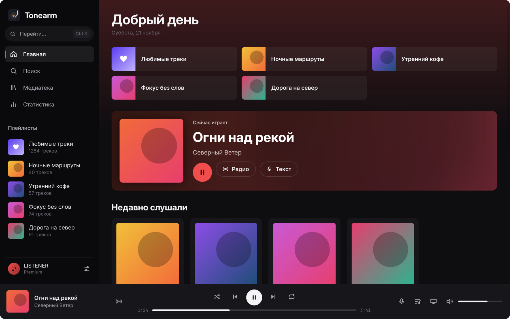
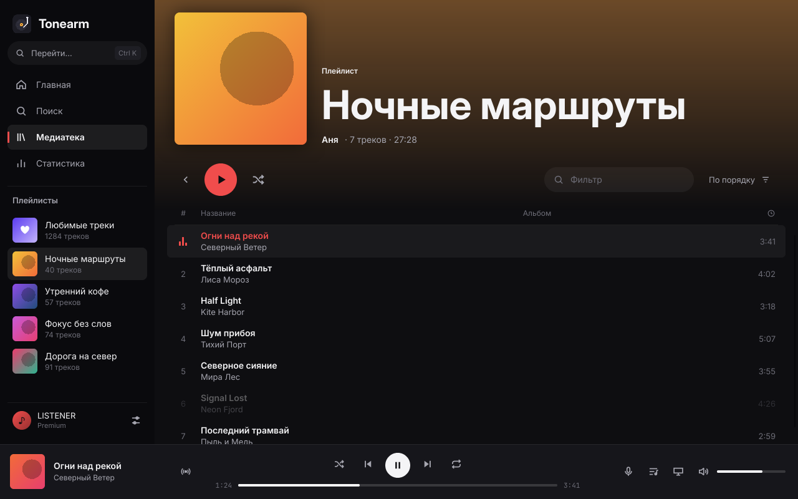
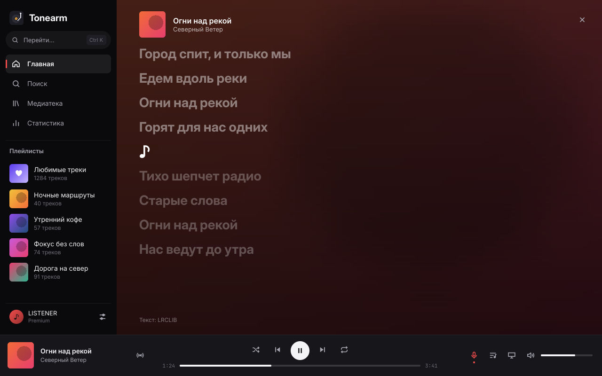
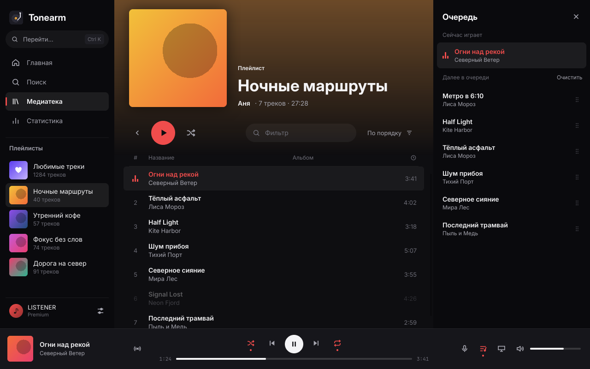
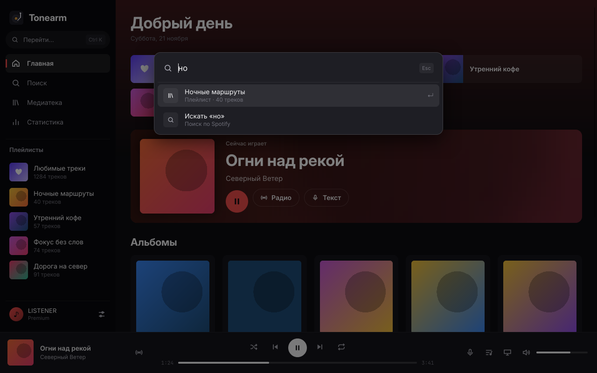
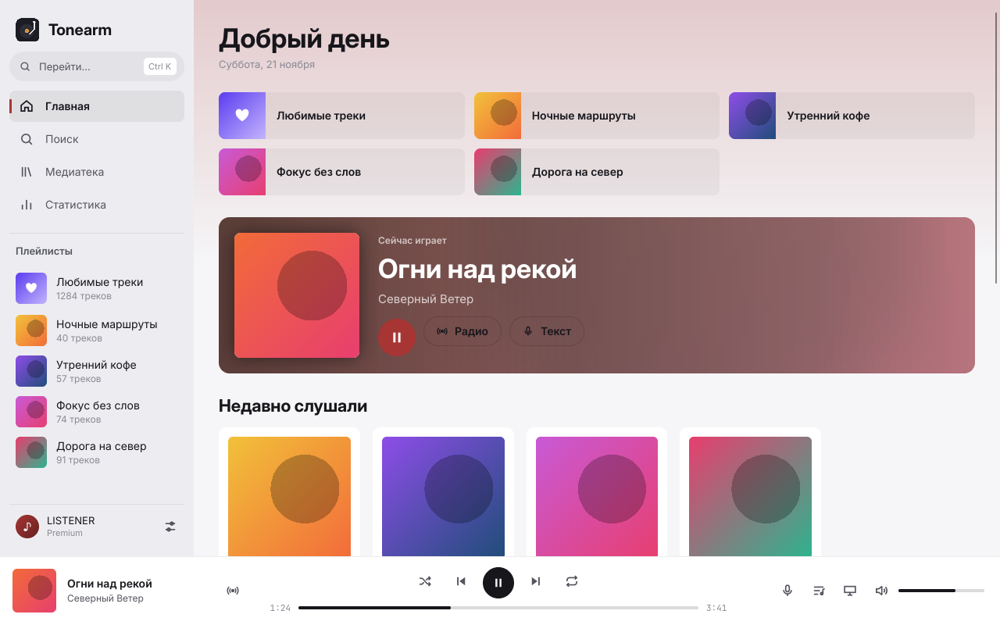
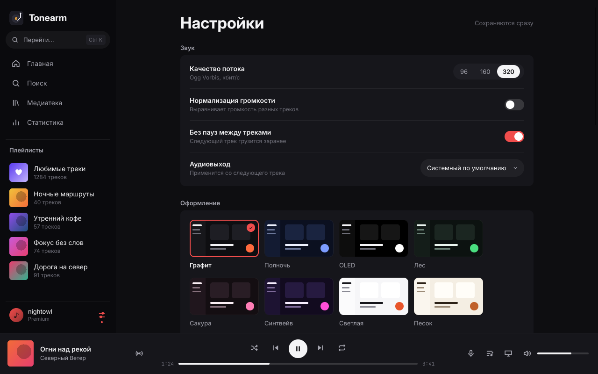

<div align="center">


# Tonearm

**Лёгкий нативный десктопный клиент для Spotify. Без Chromium, Electron и webview.**

[](https://github.com/chelond/tonearm/releases/latest)
[](https://github.com/chelond/tonearm/actions/workflows/ci.yml)
[](LICENSE)


[Скачать](https://github.com/chelond/tonearm/releases/latest) ·
[Возможности](#возможности) ·
[Установка](#установка) ·
[Сборка](#сборка-из-исходников) ·
[Вопросы](#частые-вопросы)



</div>

Tonearm написан на Rust и [Slint](https://slint.dev) и рисует интерфейс сам, поэтому не тащит за собой
браузер. Цель: меньше 100 МБ памяти в простое и быстрый холодный старт.
Работает на Linux (Wayland и X11) и Windows 10/11. Нужен аккаунт **Spotify Premium**.

> [!IMPORTANT]
> Проект неофициальный и никак не связан со Spotify AB. Воспроизведение идёт через
> [librespot](https://github.com/librespot-org/librespot), то есть через обратно-разработанный протокол,
> или через официальный фоновый плеер Spotify Soloist. Это может нарушать условия использования сервиса.
> Используйте на свой риск.

## Возможности

- **Просто войти.** Вход через браузер, пароль вводится только на странице Spotify. Регистрировать своё
  приложение и вписывать Client ID не нужно.
- **Медиатека и поиск.** Плейлисты, «Любимые треки», альбомы и артисты; фильтр и сортировка внутри плейлиста;
  поиск треков, альбомов, исполнителей и плейлистов. Ссылку Spotify можно вставить прямо в поиск.
- **Очередь.** Перемешивание, повтор, «В очередь» из контекстного меню, порядок меняется перетаскиванием.
- **Радио по треку**, **текст песни с подсветкой по словам** и **быстрый переход** по <kbd>Ctrl</kbd>+<kbd>K</kbd>.
- **Продолжение с места** после перезапуска, «Недавно слушали» и статистика за неделю.
- **Цвет от обложки.** Акцент интерфейса подстраивается под играющий трек. Восемь тем, тёмные и светлые,
  и свои темы в простом `.toml`.
- **Как родное приложение.** Медиаклавиши, виджет плеера GNOME/KDE и `playerctl` через MPRIS, системная
  панель мультимедиа на Windows, уведомление о смене трека.
- **Spotify Connect.** Перенос воспроизведения на телефон, колонку или другой компьютер и обратно.
- **Обновление одной кнопкой.** Новая версия приходит из GitHub Releases и ставится после проверки подписи.

<table>
  <tr>
    <td></td>
    <td></td>
  </tr>
  <tr>
    <td></td>
    <td></td>
  </tr>
  <tr>
    <td></td>
    <td></td>
  </tr>
</table>

## Установка

Готовые файлы лежат на странице [Releases](https://github.com/chelond/tonearm/releases/latest).

| Система | Файл | Как поставить |
|---|---|---|
| Windows 10/11 | `tonearm-windows-x86_64.zip` или `.exe` | распаковать и запустить `tonearm.exe` |
| Arch Linux | `tonearm-<версия>-1-x86_64.pkg.tar.zst` | `sudo pacman -U tonearm-*.pkg.tar.zst` |
| Другой Linux | `tonearm-linux-x86_64.tar.gz` | распаковать и запустить `./tonearm` |

Файлы `.sig` рядом с ними это подписи для встроенного обновления, скачивать их не нужно.

Дальше нажмите «Войти через браузер» и подтвердите вход на странице Spotify. Всё.

## Сборка из исходников

Нужен Rust stable 1.88 или новее (через [rustup](https://rustup.rs)).

<details open>
<summary><b>Arch Linux</b></summary>

```sh
sudo pacman -S --needed base-devel rust fontconfig libxkbcommon libxkbcommon-x11 wayland alsa-lib
cargo build --release
./target/release/tonearm
```

Или пакетом из этого репозитория: `cd packaging/arch && makepkg -si`.
</details>

<details>
<summary><b>Debian / Ubuntu</b></summary>

```sh
sudo apt install libfontconfig1-dev libxkbcommon-dev libxkbcommon-x11-0 libwayland-dev libasound2-dev
cargo build --release
```
</details>

<details>
<summary><b>Windows 10/11</b></summary>

Поставьте Rust с MSVC toolchain (`rustup default stable-x86_64-pc-windows-msvc`) и Visual Studio Build Tools
с компонентом C++.

```powershell
cargo build --release
.\target\release\tonearm.exe
```

В release-сборке нет консольного окна, иконка встроена в exe. Установщик MSI собирается через cargo-wix,
см. [packaging/windows](packaging/windows/README.md).
</details>

## Как пользоваться

### Горячие клавиши

| Клавиша | Действие |
|---|---|
| <kbd>Пробел</kbd> | играть / пауза |
| <kbd>←</kbd> <kbd>→</kbd> | перемотка на 5 с |
| <kbd>Ctrl</kbd>+<kbd>←</kbd> <kbd>Ctrl</kbd>+<kbd>→</kbd> | предыдущий / следующий трек |
| <kbd>↑</kbd> <kbd>↓</kbd> | громкость |
| <kbd>Ctrl</kbd>+<kbd>K</kbd> | быстрый переход |
| <kbd>/</kbd> или <kbd>Ctrl</kbd>+<kbd>F</kbd> | поиск |
| <kbd>Q</kbd> | очередь |
| <kbd>L</kbd> | текст песни |
| <kbd>Esc</kbd> | закрыть текст, назад со страницы плейлиста |

Клавиши работают, когда курсор не в поле ввода. Имя для MPRIS: `org.mpris.MediaPlayer2.tonearm`.

### Где хранится вход

Хранится не пароль, а многоразовый токен этого устройства. Отозвать его можно на сайте Spotify («Выйти везде»),
а кнопка «Выйти» в Tonearm удаляет его с компьютера.

- **Windows**: Credential Manager.
- **Linux**: служба секретов (GNOME Keyring, KWallet, KeePassXC), если она запущена. Ставить её не нужно:
  без неё вход сохраняется в зашифрованный файл `~/.local/share/tonearm/secrets/` (права 0600, ключ привязан
  к `/etc/machine-id` и пользователю). Если служба секретов появится позже, вход сам переедет в неё.

### Настройки и темы

Почти всё меняется на экране настроек. Он пишет `config.toml`
(Linux: `~/.config/tonearm/config.toml`, Windows: `%APPDATA%\tonearm\config\config.toml`),
пример со всеми ключами: [config.example.toml](config.example.toml). Токенов в этом файле нет.

Свои темы это файлы `.toml` в папке тем (`~/.config/tonearm/themes`, `%APPDATA%\tonearm\config\themes`).
Кнопка «Создать из текущей» кладёт туда копию выбранной темы, изменения видны сразу.
Все цвета с комментариями: [graphite.toml](crates/app/themes/graphite.toml).

### Обновления

Tonearm проверяет GitHub Releases при запуске и раз в сутки (выключается в настройках). Когда вышла новая
версия, в боковой панели появляется кнопка «Обновить».

- **Windows и портативный Linux**: новый файл подменяет старый, программа перезапускается. В папку без прав
  на запись (например, Program Files после MSI) обновиться не получится, Tonearm об этом скажет.
- **Arch**: ставится `.pkg.tar.zst` из релиза через `pkexec pacman -U`, система один раз спросит пароль.

Каждый файл подписан ключом ed25519, открытый ключ встроен в программу. Файл без верной подписи не установится.
Своё зеркало можно указать в `[update] feed_url`.

## Частые вопросы

<details>
<summary><b>Треки не играют, в журнале «audio key»</b></summary>

Некоторым аккаунтам (чаще новым) Spotify не выдаёт ключи встроенному плееру на librespot
([librespot #1649](https://github.com/librespot-org/librespot/issues/1649)). Включите
**Настройки → Плеер → Soloist**. Soloist это официальный фоновый плеер Spotify.

1. Нажмите «Получить ключ»: откроется developer.spotify.com/dashboard/soloist. Нажмите там «Copy» у своего
   ключа, Tonearm заберёт его из буфера обмена сам (или вставьте в поле и нажмите Enter). Ключ хранится в
   системном хранилище паролей.
2. Tonearm скачивает Soloist с серверов Spotify (в архив Tonearm он не входит), запускает в фоне и входит
   в него вашим аккаунтом. Если автоматический вход не прошёл, один раз выберите устройство «Tonearm»
   в Spotify на телефоне.
3. Сборки Soloist живут 90 дней, Tonearm сам скачивает новую, когда текущей больше 60 дней.

С Soloist настройки качества, нормализации и аудиовыхода не действуют: они только для встроенного плеера.
Журнал Soloist: `soloist/soloist.log` в папке данных Tonearm.
</details>

<details>
<summary><b>«Spotify ограничил запросы» (429)</b></summary>

Медиатека и поиск по умолчанию идут через внутренние запросы клиента и в лимиты Web API не упираются.
Если вы всё же видите 429 (например, в выборе устройств Connect), подключите свой Client ID:

1. На <https://developer.spotify.com/dashboard> нажмите **Create app**. Redirect URI
   `http://127.0.0.1:8898/login`, API **Web API**. Client Secret не нужен.
2. В **User Management** приложения добавьте email своего аккаунта.
3. Впишите в `config.toml`:
   ```toml
   [spotify]
   client_id = "ваш_client_id"
   ```
4. Перезапустите Tonearm и один раз разрешите доступ в браузере.
</details>

<details>
<summary><b>Нет звука на Linux</b></summary>

Встроенный плеер выводит звук через ALSA. С PipeWire нужен `pipewire-alsa`, с PulseAudio `pulseaudio-alsa`
(на большинстве десктопов уже стоят). Если аудиоустройства нет, приложение не падает: покажет сообщение,
а после подключения наушников достаточно снова нажать «Играть».
</details>

<details>
<summary><b>Вход не открывается или зависает</b></summary>

Tonearm ждёт возврата из браузера на `http://127.0.0.1:8898/login`, поэтому порт 8898 должен быть свободен.
</details>

<details>
<summary><b>Где журнал</b></summary>

Запустите с `RUST_LOG=debug tonearm`. На Windows журнал пишется в `%LOCALAPPDATA%\tonearm\data\tonearm.log`.
Токены в журнал не попадают.
</details>

## Для разработчиков

```
crates/core    сессия, вход, librespot, Soloist, медиатека, кэш, обновления
crates/player  очередь, shuffle/repeat, громкость, перемотка, события плеера
crates/app     интерфейс на Slint, общается с core и player только через каналы
packaging/     PKGBUILD и .desktop для Arch, заметки по Windows и MSI
docs/          дизайн и заметки о решениях
```

Интерфейс можно смотреть без аккаунта (только debug-сборка): `TONEARM_UI_PREVIEW=<экран> cargo run`, где экран:
`home`, `library`, `playlist`, `search`, `search-tracks`, `queue`, `lyrics`, `palette`, `stats`, `menu`,
`devices`, `settings`, `login`, `waiting`, `offline`, `update`, `update-downloading`, `update-failed`.

Рендерер по умолчанию программный (так меньше памяти). OpenGL можно попробовать через
`SLINT_BACKEND=winit-femtovg tonearm`.

Как помочь проекту и выпустить версию: [CONTRIBUTING.md](CONTRIBUTING.md). Изменения: [CHANGELOG.md](CHANGELOG.md).
Дизайн: [docs/DESIGN.md](docs/DESIGN.md). Заметки о решениях и ограничениях API: [docs/PLAN.md](docs/PLAN.md).

## Лицензия

[MIT](LICENSE). Шрифты Inter и JetBrains Mono распространяются по SIL Open Font License, тексты лицензий
лежат рядом с ними в [crates/app/ui/fonts](crates/app/ui/fonts).

Spotify — товарный знак Spotify AB. Tonearm не связан со Spotify AB и не одобрен ею.
